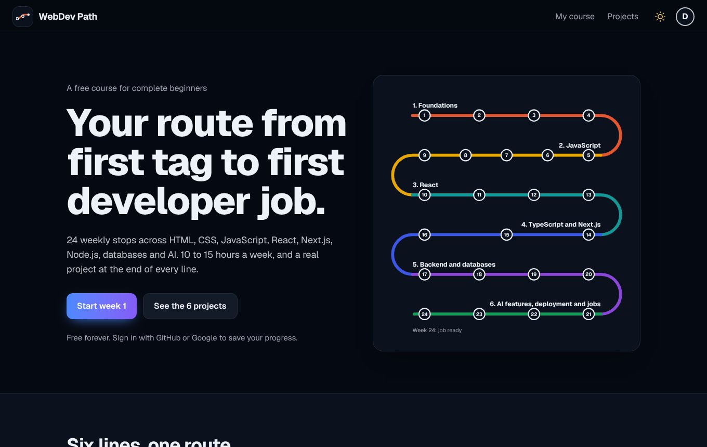
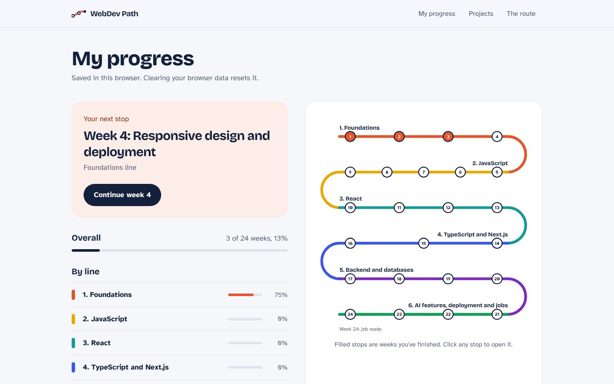
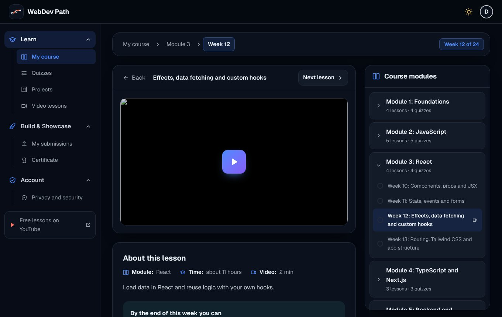
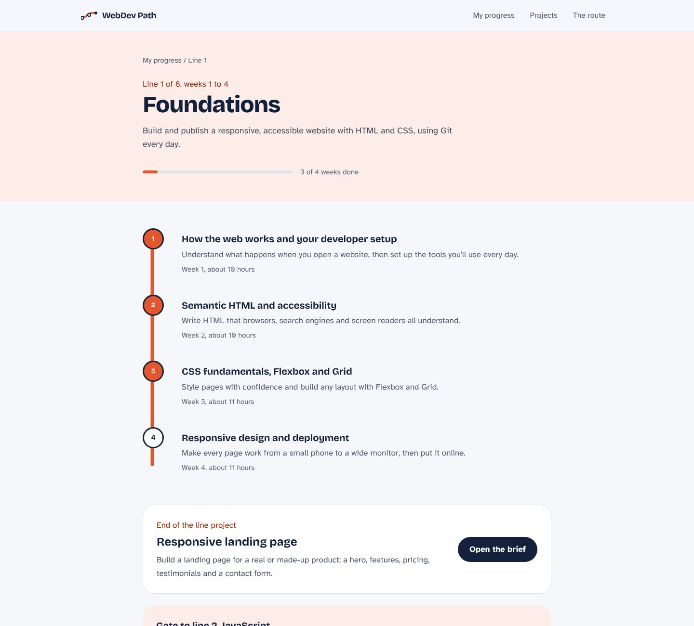
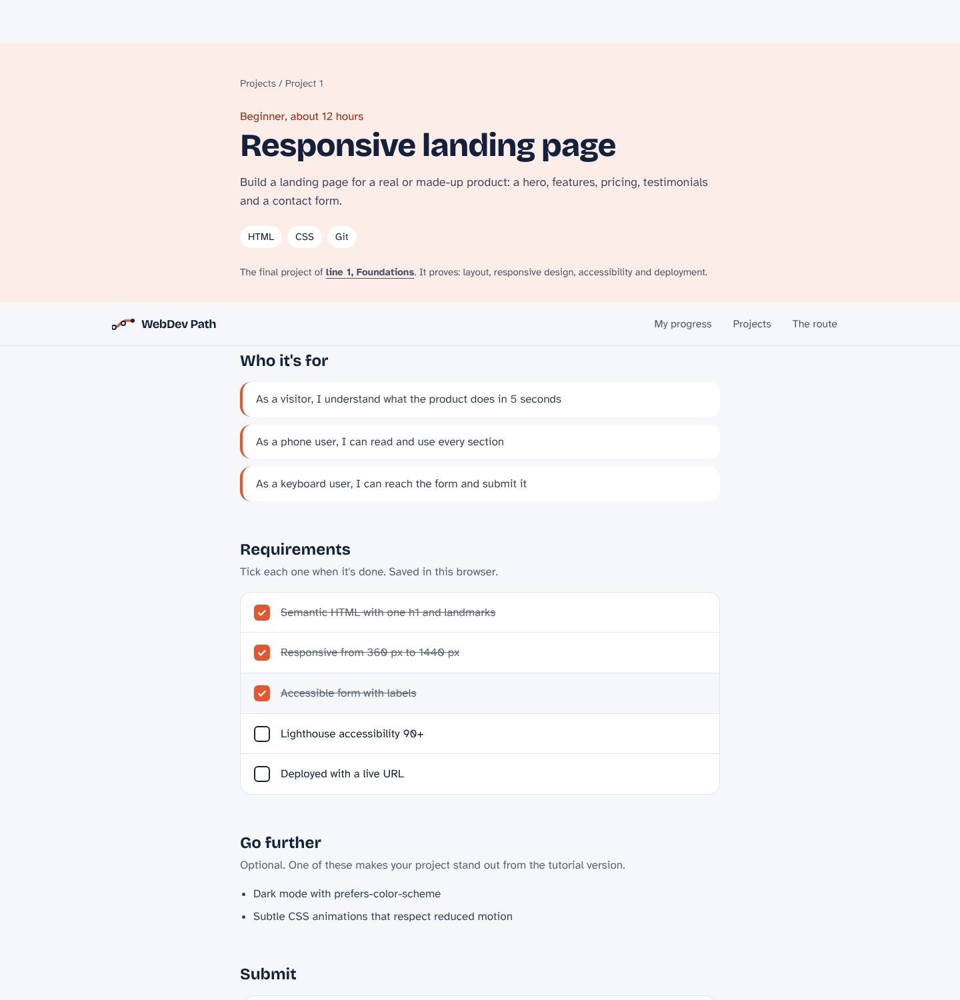
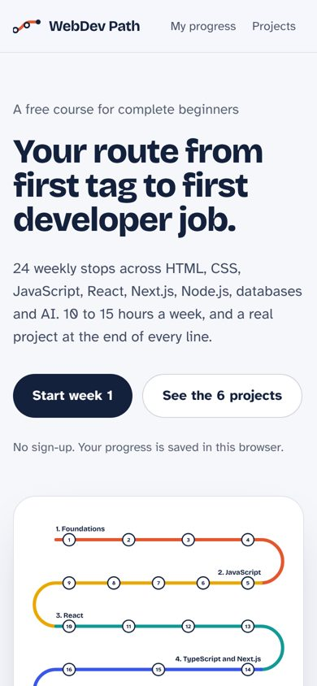
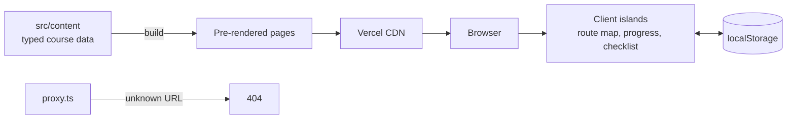

<div align="center">

# WebDev Path

**A free, open-source learning portal that takes complete beginners from their first HTML tag to their first developer job in 24 weeks.**

[](https://github.com/osamaayub/webdev-path-lms/actions/workflows/ci.yml)


[Live demo](#live-demo) · [Features](#features) · [Screenshots](#screenshots) · [Quick start](#quick-start) · [Architecture](#architecture) · [Roadmap](#roadmap)



</div>

## Why it exists

Most beginners don't fail from lack of material. They fail because there's too much of it and no clear order. WebDev Path gives one route, one week at a time, with a real project at the end of every phase and a gate you must pass before moving on.

| | |
| --- | --- |
| **6 lines** | Foundations, JavaScript, React, TypeScript and Next.js, Backend and databases, AI and careers |
| **24 weekly stops** | Each with objectives, a learn, practice and build plan, and curated free resources |
| **6 portfolio projects** | Brief, user stories, requirements checklist, stretch goals and a submission form |
| **Zero sign-up** | Progress is saved in the browser and synced across tabs |

## Live demo

Deployed on Vercel. The link is in the repo's **About** section on the right.

## Features

**For learners**
- **Route map:** the whole course drawn as a transit line. Each week is a stop that fills with the line's colour when you finish it. Click any stop to open that week.
- **My progress:** your next stop, overall and per-line progress, and a one-click "continue" button.
- **Weekly lessons:** what you'll be able to do, then three ordered steps (learn, practice, build) and hand-picked free resources.
- **Projects:** tick requirements as you go, then submit your GitHub and live URLs. URLs are validated (must be a GitHub repo and an `https` site).

**For developers reading the code**
- **Next.js 16 App Router** with Partial Prerendering: all 36 content pages are static HTML, with small client islands for progress.
- **Typed content:** the whole course is TypeScript data in `src/content`, checked by tests.
- **Pure, tested progress logic** with Zod-validated storage that resets safely if data is corrupted.
- **SEO:** per-page metadata and canonical URLs, Open Graph image, sitemap, robots, `Course` structured data, and **real 404 status codes** for unknown URLs via `proxy.ts`.
- **Accessibility:** semantic landmarks, skip link, visible focus, labelled forms, `aria-pressed`, `progressbar` and `aria-current`, reduced-motion support.
- **Performance:** self-hosted variable fonts (no Google request), no layout shift, Lighthouse 95+ on mobile.

## Screenshots

| My progress | A weekly lesson |
| --- | --- |
|  |  |

| A line (phase) | A project brief |
| --- | --- |
|  |  |

<p align="center"></p>

## Quick start

Requirements: Node.js 20 or newer.

```bash
git clone https://github.com/osamaayub/webdev-path-lms.git
cd webdev-path-lms
npm install
npm run dev
```

Open http://localhost:3000. No environment variables are needed.

### Scripts

| Command | What it does |
| --- | --- |
| `npm run dev` | Start the dev server |
| `npm run build` / `npm start` | Production build and server |
| `npm run check` | Lint, type-check and tests (what CI runs, plus `build`) |
| `npm test` | Vitest unit tests |
| `npm run typecheck` | Generate route types, then `tsc --noEmit` |

### Environment variables

| Name | Required | Description |
| --- | --- | --- |
| `NEXT_PUBLIC_SITE_URL` | No | Canonical URL for SEO tags and the sitemap. Defaults to the Vercel production URL. |

## Architecture

```
src/
  content/            The course as typed data (phases, lessons, projects) + lookups
  features/
    progress/         model.ts (pure logic + Zod), store.ts (browser storage), UI pieces
    projects/         Requirement checklist, submission form, status badge
    route/            The route map component
  components/         Header, footer, logo, buttons, progress bar
  config/             Site info (SEO) and line colours
  fonts/              Self-hosted Bricolage Grotesque and Atkinson Hyperlegible
  app/                Routes only: home, /learn, /learn/[phase], /learn/[phase]/[lesson],
                      /projects, /projects/[slug], sitemap, robots, OG image, 404
  proxy.ts            Real 404 for unknown lesson, line or project URLs
test/                 Content integrity and progress tests
docs/                 ARCHITECTURE.md and screenshots
```



Design decisions, the request flow and the plan for accounts: **[docs/ARCHITECTURE.md](docs/ARCHITECTURE.md)**.

### Design system

| Token | Value | Used for |
| --- | --- | --- |
| Ink | `#14213D` | Text, primary buttons, stop outlines |
| Paper | `#F6F7FB` | Page background |
| Line colours | `#E4572E` `#E9A800` `#139A98` `#3A57E8` `#7B2CBF` `#0F9D58` | One per phase, so you always know which line you're on |
| Display type | Bricolage Grotesque | Headings |
| Body type | Atkinson Hyperlegible | Body text, designed for readability |

## Editing the course

All content lives in `src/content`:

- Add or edit a week in `phases.ts`, or a project in `projects.ts`.
- Pages, navigation, the route map, the sitemap and 404 handling update automatically.
- `npm test` fails if weeks skip or repeat, a slug is duplicated, a phase points to a missing project, or a resource isn't `https`.

## Deploy

1. Import the repo on [Vercel](https://vercel.com/new).
2. Deploy. No environment variables are required.
3. Optional: add a custom domain and set `NEXT_PUBLIC_SITE_URL` to it.

## Roadmap

- [ ] Accounts and cloud progress (Auth.js + Postgres) behind the existing progress model
- [ ] Mentor review and feedback on submitted projects
- [ ] Video lessons embedded from [YouTube](https://www.youtube.com/@osamaayubdev)
- [ ] Certificate when all six projects are submitted
- [ ] Dark mode

## Contributing

Issues and pull requests are welcome. Please run `npm run check` before opening a PR.

## Author

Built by **[Osama Ayub](https://osama-ayubpersonal.vercel.app/)**, full-stack developer (React, Next.js, Node.js, AI integration).
Need a web app, dashboard or AI feature? [Hire me on Upwork](https://www.upwork.com/freelancers/~01c0c3cf471b66a427).

## License

Code: [MIT](LICENSE). Fonts: SIL Open Font License (see `src/fonts`).
