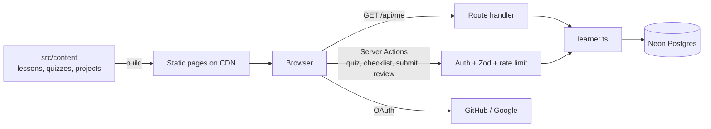

<div align="center">

# WebDev Path

**A free, open-source LMS that takes complete beginners from their first HTML tag to their first developer job in 24 weeks: modules, quizzes, graded assignments and progress tracking.**

[](https://github.com/osamaayub/webdev-path-lms/actions/workflows/ci.yml)


[Live demo](https://webdev-path-lms.vercel.app) · [Features](#features) · [Screenshots](#screenshots) · [Quick start](#quick-start) · [Architecture](#architecture) · [Roadmap](#roadmap)


</div>

## Why it exists

Most beginners don't fail from lack of material. They fail because there's too much of it and no clear order. WebDev Path gives one route, one week at a time, with a real project at the end of every phase and a gate you must pass before moving on.

| | |
| --- | --- |
| **6 lines** | Foundations, JavaScript, React, TypeScript and Next.js, Backend and databases, AI and careers |
| **24 weekly stops** | Each with objectives, a learn, practice and build plan, and curated free resources |
| **6 portfolio projects** | Brief, user stories, requirements checklist, stretch goals and a submission form |
| **Zero sign-up** | Progress is saved in the browser and synced across tabs |

## Live demo

**[webdev-path-lms.vercel.app](https://webdev-path-lms.vercel.app)**, deployed on Vercel. Every push to `main` redeploys automatically.

## Features

**For learners**
- **Sign in with GitHub or Google.** No passwords. Progress follows you to any device.
- **Route map:** the whole course drawn as a transit line. Each week is a stop that fills with the line's colour when you pass it.
- **24 weekly modules:** objectives, then three steps (learn, practice, build) and hand-picked free resources.
- **120 quiz questions:** a 5-question quiz closes every week. Score 4 of 5 to complete it. Wrong answers come back with an explanation; best score and attempts are kept.
- **6 graded assignments:** tick the requirements, submit your GitHub repo and live link, and get a grade out of 100 with written feedback. Resubmit after "changes requested".
- **My progress:** next stop, overall and per-line progress.
- **Privacy page and self-service account deletion** (removes every record).

**For reviewers (admins)**
- **Review dashboard at `/admin`:** stats (learners, in review, approved, weeks completed, quiz attempts), filter by status, oldest first, approve or request changes with a grade and feedback.
- Admins are an email allowlist (`ADMIN_EMAILS`); everyone else gets a 404.

**Engineering**
- **Next.js 16 App Router** with Partial Prerendering: all course pages are static HTML on the CDN. Personal data loads from one private `/api/me` call.
- **Neon Postgres + Drizzle ORM** with SQL migrations applied on every deploy. node-postgres pool attached to Vercel Fluid compute, as Neon recommends.
- **Auth.js v5** (GitHub, Google) with the Drizzle adapter and signed JWT session cookies.
- **Server Actions** for every write: authenticate, validate with Zod against the course content, rate-limit, then touch only the caller's rows.
- **Security:** strict CSP, HSTS, no framing, server-graded quizzes, allowlisted admins, open-redirect-safe sign-in, structured logs without secrets. See [SECURITY.md](SECURITY.md).
- **Tests:** 29 Vitest tests, including server actions against a real Postgres (PGlite) with migrations, plus a Playwright end-to-end run of the full learner and reviewer flow.
- **SEO and accessibility:** metadata, sitemap, Open Graph image, real 404s, landmarks, labelled forms, keyboard support, reduced motion.

## Screenshots

| My progress | A weekly lesson |
| --- | --- |
|  |  |

| A line (phase) | A project brief |
| --- | --- |
|  |  |

<p align="center"></p>

## Quick start

Requirements: Node.js 20 or newer.

```bash
git clone https://github.com/osamaayub/webdev-path-lms.git
cd webdev-path-lms
npm install
npm run dev
```

Open http://localhost:3000. The course works with no environment variables (read-only).

To try accounts, quizzes and grading locally without any cloud services:

```bash
cp .env.example .env.local
# then set in .env.local:
#   DATABASE_URL=pglite:///tmp/webdev-path-db   (real Postgres in WASM, outside the repo)
#   AUTH_SECRET=<output of: npx auth secret>
#   AUTH_DEV_LOGIN=1                             (email-only login, dev only)
#   ADMIN_EMAILS=you@example.com
npm run db:migrate
npm run dev
```

### Scripts

| Command | What it does |
| --- | --- |
| `npm run dev` | Start the dev server |
| `npm run build` / `npm start` | Production build and server |
| `npm run check` | Lint, type-check and tests (what CI runs, plus `build`) |
| `npm test` | Vitest unit tests |
| `npm run typecheck` | Generate route types, then `tsc --noEmit` |
| `npm run db:generate` | Create a SQL migration from changes to `src/server/db/schema.ts` |
| `npm run db:migrate` | Apply migrations (also runs automatically before `build`) |

### Environment variables

| Name | Required | Description |
| --- | --- | --- |
| `DATABASE_URL` | For accounts | Neon pooled URL. Set by the Neon integration on Vercel. |
| `DATABASE_URL_UNPOOLED` | Recommended | Neon direct URL, used for migrations. Set by the integration. |
| `AUTH_SECRET` | For accounts | Signs session cookies. `npx auth secret` |
| `AUTH_GITHUB_ID` / `AUTH_GITHUB_SECRET` | One provider | GitHub OAuth app |
| `AUTH_GOOGLE_ID` / `AUTH_GOOGLE_SECRET` | One provider | Google OAuth client |
| `ADMIN_EMAILS` | For reviewing | Comma-separated reviewer emails |
| `AUTH_DEV_LOGIN` | No | `1` enables an email-only login in development. Ignored in production. |
| `NEXT_PUBLIC_SITE_URL` | No | Canonical URL for SEO tags and the sitemap. Defaults to the Vercel production URL. |

Without a database and a provider the site stays fully readable and shows "Accounts are being set up" where personal features would be. See `.env.example` for where each value comes from.

## Architecture

```
src/
  content/            The course as typed data: phases, lessons, projects, quizzes
  server/             Server-only code
    db/               Drizzle schema + client (Neon in prod, PGlite locally)
    auth.ts           Auth.js config: providers, adapter, admin allowlist
    viewer.ts         getViewer / requireUser / requireAdmin
    learner.ts        All queries, scoped to the signed-in user's id
    logger.ts, action-result.ts
  features/
    progress/         model.ts (pure rules + Zod), actions.ts (server actions), store.ts (client cache of /api/me)
    quiz/             The weekly quiz
    projects/         Checklist, submission form, status badge
    admin/            Review form + action
    auth/             Sign-in/out/delete actions, account menu, sign-in prompt
    route/            The route map
  app/                Routes: home, /learn/..., /projects/..., /sign-in, /admin, /security, /api/me, /api/auth
  proxy.ts            Real 404 for unknown lesson, line or project URLs
drizzle/              SQL migrations
scripts/migrate.mjs   Applies migrations before each build
test/                 Content, grading, validation and server-action tests
```



Design decisions, the request flow and the plan for accounts: **[docs/ARCHITECTURE.md](docs/ARCHITECTURE.md)**.

### Design system

| Token | Value | Used for |
| --- | --- | --- |
| Ink | `#14213D` | Text, primary buttons, stop outlines |
| Paper | `#F6F7FB` | Page background |
| Line colours | `#E4572E` `#E9A800` `#139A98` `#3A57E8` `#7B2CBF` `#0F9D58` | One per phase, so you always know which line you're on |
| Display type | Bricolage Grotesque | Headings |
| Body type | Atkinson Hyperlegible | Body text, designed for readability |

## Editing the course

All content lives in `src/content`:

- Add or edit a week in `phases.ts`, or a project in `projects.ts`.
- Pages, navigation, the route map, the sitemap and 404 handling update automatically.
- `npm test` fails if weeks skip or repeat, a slug is duplicated, a phase points to a missing project, or a resource isn't `https`.

## Deploy

1. Import the repo on [Vercel](https://vercel.com/new).
2. In Vercel, **Storage / Integrations → Neon → Link existing account**, pick this project. It sets `DATABASE_URL` and `DATABASE_URL_UNPOOLED`.
3. Create a GitHub OAuth app (and optionally a Google client) with the callback URLs from `.env.example`.
4. Add `AUTH_SECRET`, the provider IDs and secrets (as **Secret** type), and `ADMIN_EMAILS` in Project → Settings → Environment Variables.
5. Redeploy. Migrations run before the build, so the tables are created automatically.

## Roadmap

- [x] Accounts and cloud progress (Auth.js + Neon Postgres)
- [x] Weekly quizzes graded on the server
- [x] Graded project reviews with feedback
- [ ] Email when a project is reviewed
- [ ] Video lessons embedded from [YouTube](https://www.youtube.com/@osamaayubdev)
- [ ] Certificate when all six projects are approved
- [ ] Dark mode

## Contributing

Issues and pull requests are welcome. Please run `npm run check` before opening a PR.

## Author

Built by **[Osama Ayub](https://osama-ayubpersonal.vercel.app/)**, full-stack developer (React, Next.js, Node.js, AI integration).
Need a web app, dashboard or AI feature? [Hire me on Upwork](https://www.upwork.com/freelancers/~01c0c3cf471b66a427).

## License

Code: [MIT](LICENSE). Fonts: SIL Open Font License (see `src/fonts`).
