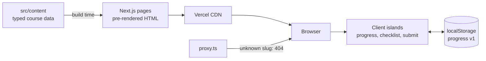
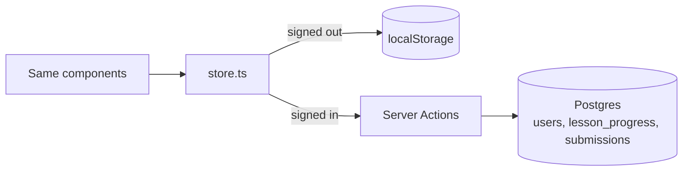

# Architecture and system design

## Goals

| Goal | How |
| --- | --- |
| Instant page loads, great SEO | Content is static data; every page is pre-rendered at build time and served from the CDN |
| No sign-up to start learning | Progress lives in the browser (localStorage), behind a small store |
| Easy to grow into a real LMS | Progress is plain data with pure functions, so a database can replace the storage without UI changes |
| Content anyone can edit safely | Typed content files, checked by tests on every push |

## System overview



## Layers

```
content/     What is taught (data only, no React)
features/    What users do (progress, projects): model, store, components
components/  Shared presentational pieces
app/         Routes: read content, render pages, place client islands
```

Rules:

1. Pages are Server Components and read content directly. Only the parts that change per user (progress bars, buttons, forms) are Client Components.
2. `features/progress/model.ts` has no React or browser code. It is pure functions over a Zod-validated shape, so it is unit tested and reusable on a server.
3. `features/progress/store.ts` is the only file that touches `localStorage`. It uses `useSyncExternalStore`, renders empty on the server (no hydration mismatch), and syncs across tabs through the `storage` event.

## Key decisions

**Content as TypeScript, not a CMS.** For one author and 24 lessons, typed files give autocomplete, review in pull requests and zero runtime cost. A CMS can be added later behind the same `content/index.ts` functions.

**Progress in the browser first.** Learners start in one click. Stored data is versioned (`version: 1`) and validated on read, so corrupted or old data resets instead of crashing.

**Real 404s.** With Partial Prerendering, `notFound()` in a streamed page would return status 200. `proxy.ts` checks the path against `content/routes.ts` and returns a true 404, so search engines never index missing pages.

**Validation at the edge of the system.** Project submissions are parsed with Zod (GitHub repo URL, https live URL). The same schema can run on a server later.

## Moving to accounts (next step)



1. Add Auth.js and a Postgres database (Neon or Turso).
2. Tables: `users`, `lesson_progress(user_id, lesson_id, completed_at)`, `project_progress(user_id, project_slug, checked, repo_url, live_url, submitted_at)`.
3. Server Actions reuse `toggleLesson`, `toggleRequirement` and `submitProject` from `model.ts`, check the session, and write rows.
4. On first sign-in, import the browser progress once.

The UI does not change: only `store.ts` gains a second adapter.

## Testing

- **Content tests:** weeks 1 to 24 in order, lessons inside their phase's range, unique slugs, phase-project links, https resources.
- **Progress tests:** parsing corrupted data, toggles, percent, next lesson, submission validation.
- **CI:** lint, type-check (with generated route types), tests and a production build on every push.
