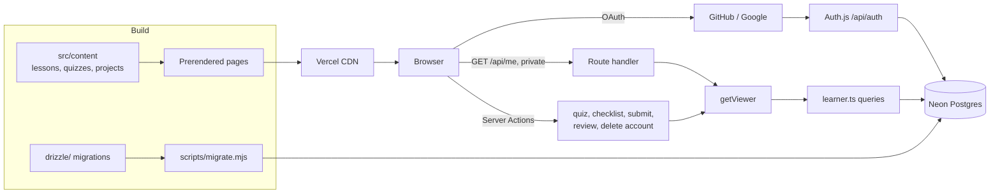

# Architecture and system design

## Goals

| Goal | How |
| --- | --- |
| Instant page loads, great SEO | Course content is typed data; every lesson, line and project page is prerendered and served from the CDN |
| Real LMS features | Accounts, quizzes, graded assignments, reviewer dashboard, all backed by Postgres |
| Secure by default | Every write is a Server Action that authenticates, validates and only touches the caller's rows |
| Readable without an account | Personal data loads separately, so the course works for everyone and for search engines |
| Content anyone can edit safely | Typed files, checked by tests on every push |

## System overview



## Layers

```
content/         What is taught. Data only, no React. Quiz answers live here and never leave the server.
server/          Server-only (import "server-only"): db client, auth, viewer, queries, logging.
features/<x>/    What users do: model.ts (pure rules + Zod), actions.ts (Server Actions), components/.
components/      Shared presentational pieces.
app/             Routes. Read content, render pages, place client islands.
```

Rules:

1. **Pages stay static.** Content pages never read cookies. Personal UI is a client island that reads one cached snapshot of `/api/me` (`features/progress/store.ts`, `useSyncExternalStore`, refreshed on mount and tab focus). This keeps all 36 course pages on the CDN while each learner sees their own progress.
2. **Writes go through Server Actions** in `features/*/actions.ts`. Each one: `requireUser()` or `requireAdmin()`, Zod-validate, check against the course content, rate-limit, call `server/learner.ts`. Errors become safe messages via `safely()`.
3. **Queries live in one file** (`server/learner.ts`) and always take the user id from the session.
4. **Pure rules are shared.** `features/progress/model.ts` (grading, schemas, progress maths) runs in tests, actions and the browser.

## Data model

```mermaid
erDiagram
  user ||--o{ account : "OAuth logins"
  user ||--o{ lesson_progress : completes
  user ||--o{ quiz_attempt : takes
  user ||--o{ project_checklist : ticks
  user ||--o{ submission : submits
  user ||--o{ submission : "reviews (reviewed_by)"

  lesson_progress { text user_id PK; text lesson_id PK; timestamp completed_at }
  quiz_attempt { uuid id PK; text user_id; text lesson_id; int score; int total; bool passed; jsonb answers; timestamp created_at }
  project_checklist { text user_id PK; text project_slug PK; jsonb checked }
  submission { uuid id PK; text user_id; text project_slug; text repo_url; text live_url; text notes; enum status; int grade; text feedback; int attempts }
```

- Course content (lesson ids, project slugs) is referenced by string id, not foreign keys: content is versioned in Git, data in Postgres.
- `ON DELETE CASCADE` from `user` means deleting an account removes every learner record.
- Indexes: `(user_id, lesson_id, created_at)` for attempt history and rate limits; unique `(user_id, project_slug)` for submissions; `(status, updated_at)` for the review queue.

## Key flows

**Quiz:** client sends `lessonId` + chosen indexes → action checks the session, the lesson, the answer count and range, and the hourly limit → grades against `content/quizzes.ts` → stores the attempt → if passed, inserts `lesson_progress` (idempotent) → returns per-question results with explanations.

**Assignment:** learner ticks requirements (stored per index, validated against the project) → submit requires every requirement ticked and valid GitHub + https URLs → status `submitted` → reviewer approves or requests changes with a grade (0 to 100) and feedback → learner sees it on the project page; resubmitting increments `attempts` and returns it to the queue. Approved work is locked.

## Key decisions

**Neon + node-postgres on Vercel.** Neon's guidance for Vercel Fluid compute is a `pg` pool attached with `attachDatabasePool`, on the pooled URL. Migrations use the direct (unpooled) URL. Locally and in tests, the same Drizzle code runs on PGlite (Postgres compiled to WASM), so tests hit a real Postgres with the real migrations.

**Migrations on deploy.** `npm run build` runs `scripts/migrate.mjs` first. Drizzle records applied migrations, so it's safe to repeat. Without `DATABASE_URL` it skips, and the site runs read-only.

**JWT sessions with a database adapter.** Users and OAuth accounts are stored in Postgres, but the session is a signed cookie, so pages don't hit the database just to know who you are.

**Admins by allowlist.** No role column to tamper with or forget to migrate. Changing reviewers is an env change.

**Content as TypeScript, not a CMS.** For one author, typed files give autocomplete, review in pull requests and zero runtime cost. Tests enforce 24 weeks, 5 questions per quiz, valid answers and unique slugs.

**Real 404s.** With Partial Prerendering, `notFound()` in a streamed page would return 200. `proxy.ts` checks the path against `content/routes.ts` and returns a true 404.

**Route map as the core UI.** The course is a sequence, so the main visual is a transit line: one coloured line per phase, one stop per week. Stops fill when you pass the week's quiz.

**Self-hosted font.** Geist (variable) via `next/font/local`: no third-party request (CSP stays `font-src 'self'`) and no layout shift.

## Security

See [SECURITY.md](../SECURITY.md) for the threat model and where each control lives.

**App shell and theme.** `AppShell` (client) gives every learning page a top bar, a sidebar with collapsible groups and a mobile drawer; the home page keeps only the top bar. The theme lives in CSS variables on `:root[data-theme]`. A tiny inline script in `<head>` sets `data-theme` from localStorage before first paint, so there is no flash. The theme toggle reads that attribute with `useSyncExternalStore`.

**Video lessons.** `src/content/videos.ts` maps YouTube videos to lessons. The player shows the thumbnail first and only loads the youtube-nocookie iframe when the learner presses play. The CSP allows `i.ytimg.com` images and `youtube-nocookie.com` frames, nothing else from YouTube.

**Sign out and account deletion** clear the session in a server action, then the client does a full page load to `/`, so no signed-in UI or cached state survives.
